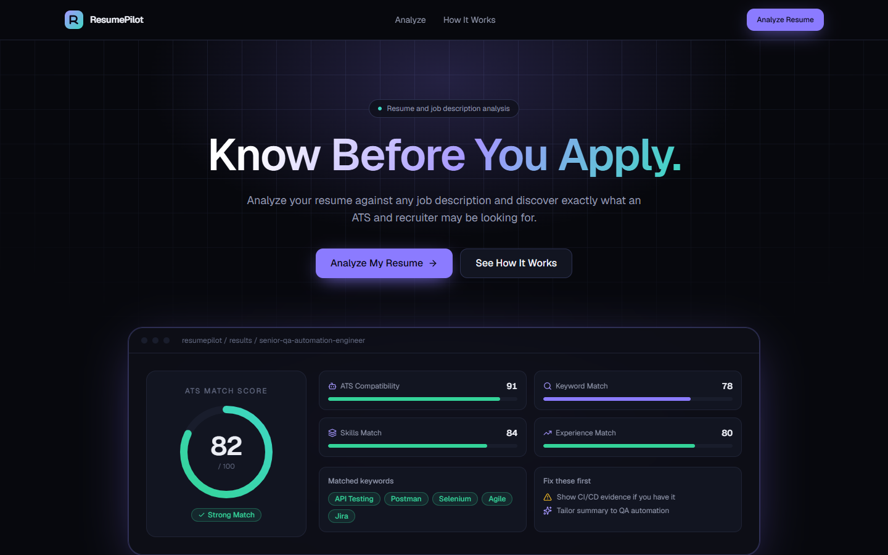
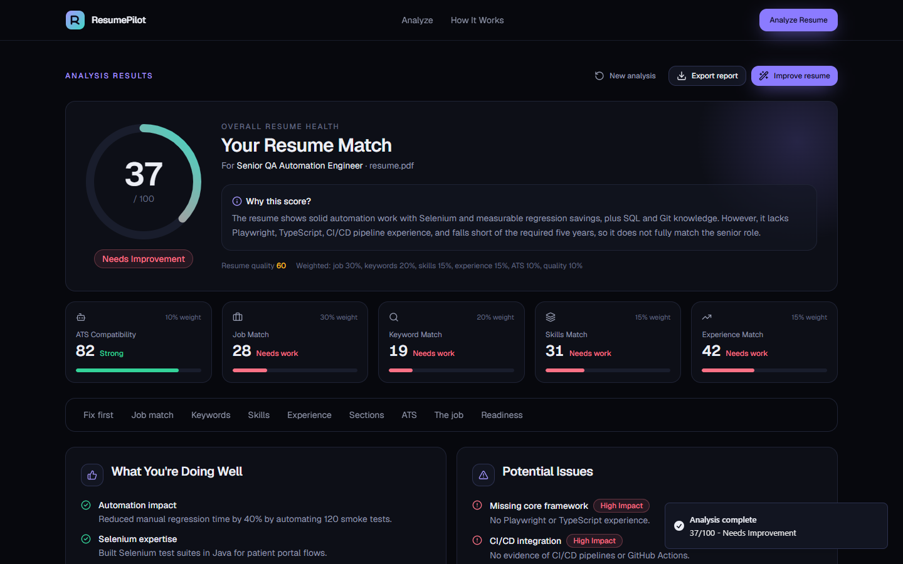
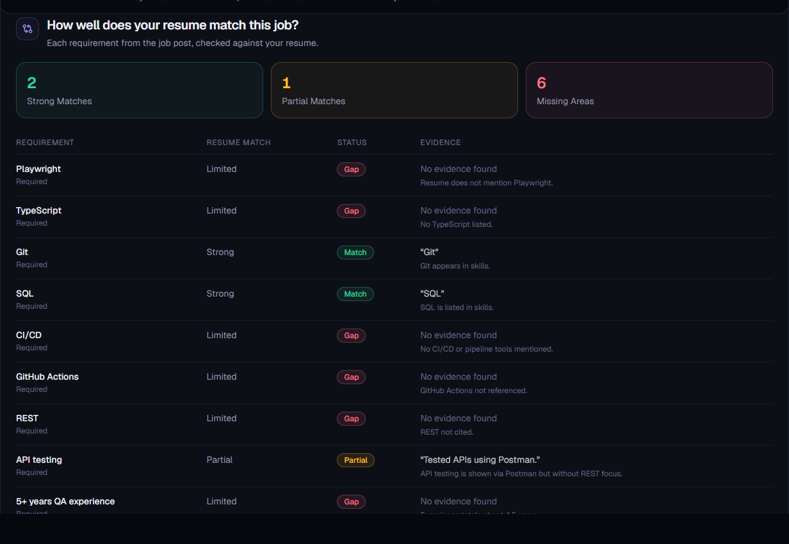
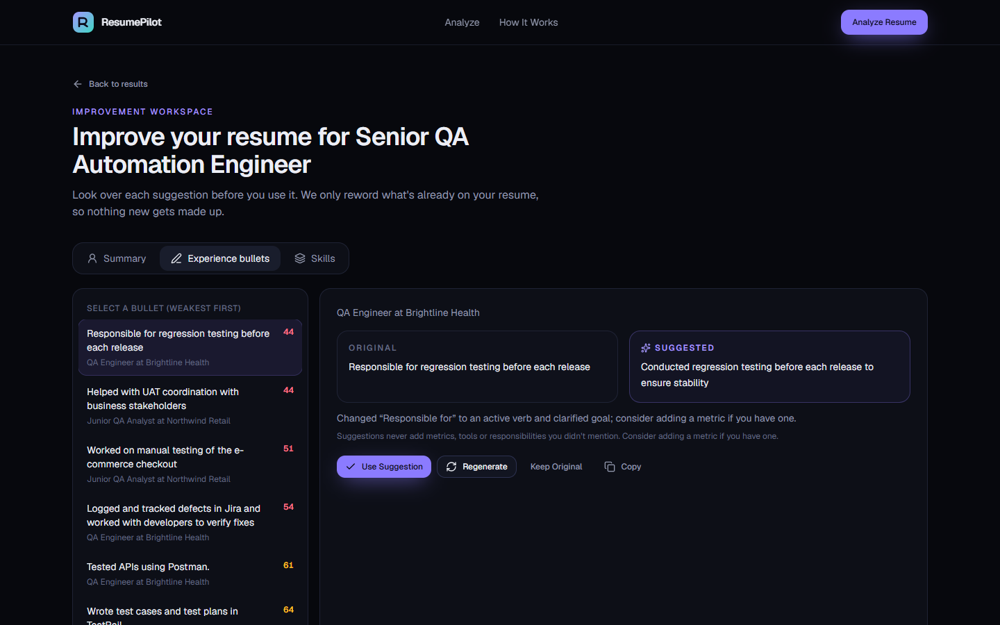

# ResumePilot

**AI ATS Resume Analyzer.** Know before you apply.

ResumePilot checks your resume against a specific job description and tells you how well you match, why you got that score, and what to fix first. It reads your resume the way an applicant tracking system (ATS) would, compares it with what the employer is asking for, and helps you improve the wording without making anything up.



## Why I built this

Most resume checkers give you a number and a generic list of tips. I wanted something that explains its score, points to the exact lines in your resume it's judging, and is honest when a skill is missing instead of telling you to stuff keywords in. So the flow goes beyond "upload and get a score":

**Upload resume -> Paste the job -> See the match -> Find the gaps -> Fix the important things first -> Improve the wording -> Final readiness check**

## Features

### Analysis

- **Overall match score** out of 100, built from six weighted parts so you can see exactly where it comes from:

  | Part | Weight |
  | --- | --- |
  | Job match | 30% |
  | Keyword alignment | 20% |
  | Skills alignment | 15% |
  | Experience relevance | 15% |
  | ATS compatibility | 10% |
  | Resume quality | 10% |

  Labels: 90+ Excellent Match, 80+ Strong Match, 70+ Good Match, 60+ Moderate Match, below 60 Needs Improvement.

- **Job match table:** every key requirement from the posting marked Match, Partial or Gap, with the line from your resume it was matched to.
- **Keyword analysis:** matched, underused and missing keywords. Click one to see why it matters for this job.
- **Skills gap:** strong, partial and missing skills with coverage bars.
- **Experience review:** how relevant each role is, its strengths and weak spots, and a score for every bullet point (action verb, technical detail, clarity, impact, metric, relevance).
- **Section review:** summary, experience, skills, education, projects, certifications and formatting. Sections the job doesn't need don't count against you.
- **ATS formatting check:** standard headings, readable contact details, tables, multi-column layouts, date formats, odd symbols and keyword visibility.
- **Understanding this job:** title, seniority, top skills, responsibilities and likely recruiter priorities.
- **Fix These First:** a short ranked list of changes, each with what to change, why it matters and which section it affects.





### Improvement workspace

- Suggested professional summary with Copy and Use Suggestion.
- Bullet-by-bullet rewrites shown side by side with the original, with Use Suggestion, Regenerate and Keep Original.
- Skills advice: what to put first, what's relevant but buried, and which job skills to add only if you really have them.
- A list of the changes you've accepted, ready to copy into your resume.
- An application readiness check that updates as you accept changes.



### Report

A clean, printable report at `/report`. Use **Print / Save as PDF** to keep a copy.

## Honest suggestions only

The app never invents experience, employers, job titles, certifications, degrees, projects, tools, metrics or years of experience. It only rewords what's already in your resume.

This isn't just a prompt instruction. Every rewrite is checked in code (`lib/analysis/integrity.ts`). Any suggestion that adds a number, skill, seniority word or leadership claim not found in your resume is thrown out. If a metric would help, the app says "Consider adding a metric if you have one" rather than making one up. Recommendations that mention a skill you don't have are marked "Only add this if you genuinely have this experience."

## Tech stack

- [Next.js 16](https://nextjs.org) (App Router) with TypeScript in strict mode
- React 19
- Tailwind CSS v4, with shadcn-style components built on Radix UI
- Lucide icons and Framer Motion
- Zod for validating every AI response
- `unpdf` for PDF text and `mammoth` for DOCX text
- Groq (`openai/gpt-oss-120b`) as the default AI provider

There's no database and no login.

## Getting started

You'll need Node.js 20 or newer.

```bash
git clone <your-repo-url>
cd resumepilot
npm install
cp .env.example .env.local
```

Open `.env.local` and add your API key (see below), then start the app:

```bash
npm run dev
```

Go to http://localhost:3000.

### Scripts

| Command | What it does |
| --- | --- |
| `npm run dev` | Start the development server |
| `npm run build` | Build for production (includes type checking) |
| `npm start` | Run the production build |
| `npm run lint` | Run ESLint |

## Environment variables

| Variable | Required | Description |
| --- | --- | --- |
| `AI_API_KEY` | Yes, for AI analysis | Your provider's API key. Only ever used on the server. |
| `AI_PROVIDER` | No | `groq` (default), `openai` or `openai-compatible` |
| `AI_MODEL` | No | Overrides the default model for the provider |
| `AI_BASE_URL` | Only for `openai-compatible` | Base URL of any OpenAI-compatible API |
| `AI_CONCURRENCY` | No | How many AI requests run at once. Defaults to 1 for Groq, 4 otherwise. |

Example `.env.local` for Groq (get a free key at [console.groq.com](https://console.groq.com)):

```env
AI_PROVIDER=groq
AI_API_KEY=your_key_here
AI_MODEL=openai/gpt-oss-120b
```

`.env.local` is in `.gitignore`. Never commit it.

**No key?** The app still runs. It switches to built-in rule-based checks (keyword matching, scoring and ATS formatting) and shows a note on the results page saying the AI parts were skipped.

## How the analysis works

1. **Parsing.** The uploaded file is checked server-side: extension, MIME type, file signature, size (5 MB max) and whether it actually has readable text. Scanned PDFs, empty files and corrupted files get a clear error message.
2. **Extraction.** The AI turns the resume and the job description into structured data (roles, bullets, skills, requirements and so on). Both calls run at the same time.
3. **Review.** Three focused AI calls compare the resume with the job, review each role and bullet, and review the sections and formatting. Using separate prompts gives more reliable results than one huge prompt.
4. **Scoring.** Keyword presence, bullet quality and ATS checks are calculated in code. The final score comes from the weighted formula above and isn't left to the AI.
5. **Validation.** Every AI response is validated against a Zod schema. If a response is malformed, it's retried. If an AI step still fails, that part falls back to the built-in checks and the results page tells you.

Groq's free tier allows 8,000 tokens per minute, so requests are queued one at a time and automatically wait out rate limits. A full analysis usually takes about a minute.

### Using a different AI provider

All AI calls go through one small interface in `lib/ai/provider.ts`:

```ts
interface AIProvider {
  generateJSON<T>(options: { system: string; prompt: string; schema: ZodType<T>; name: string }): Promise<T>;
}
```

Any OpenAI-compatible API works out of the box. Set `AI_PROVIDER=openai-compatible` with `AI_BASE_URL` and `AI_MODEL`. To support something else, implement `AIProvider` and add it to `getProvider()`.

## Privacy

- No database. Uploaded files are read in memory and thrown away after the analysis.
- Resume content is never written to logs. Server logs only record error types.
- Results are stored in your browser tab (`sessionStorage`) and disappear when you close it.
- The browser only gets the analysis and the bits of your resume needed for the improvement workspace (summary, skills and bullets), never the full extracted text.
- Everything is rendered as plain text. Nothing from a resume is ever rendered as HTML.
- API keys stay on the server and are never sent to the browser.

## Project structure

```
app/
  page.tsx               Home page
  analyze/               Upload and job description workspace
  results/               Results dashboard
  improve/               Improvement workspace
  report/                Printable report
  api/analyze/           Parses the upload and runs the analysis
  api/improve/           Generates summary and bullet rewrites
components/
  ui/                    Buttons, cards, badges, score ring, progress bars
  layout/                Header, footer, logo
  landing/ analyze/ results/ improve/
lib/
  ai/                    Provider, prompts and the analysis pipeline
  analysis/              Scoring, keyword matching, ATS checks, bullet scoring, integrity checks
  parsing/               PDF and DOCX extraction, upload validation, resume and job parsing
  schemas.ts             Zod schemas and shared types
  session.ts             Browser session storage
docs/screenshots/        Images used in this README
```

## Deploying to Vercel

1. Push the project to GitHub.
2. Import the repository at [vercel.com/new](https://vercel.com/new).
3. Under **Settings -> Environment Variables**, add `AI_API_KEY` (and `AI_PROVIDER` / `AI_MODEL` if you're not using the defaults).
4. Deploy.

The analyze route allows up to 300 seconds. On the free Groq tier an analysis takes about a minute, which fits comfortably.

## A note on ATS scores

There's no single ATS. Workday, Greenhouse, Lever and the rest each work differently, and none of them publish how they rank candidates. ResumePilot gives you an ATS compatibility assessment based on common parsing problems and how closely your resume matches the job. Treat the score as a guide, not a guarantee.
